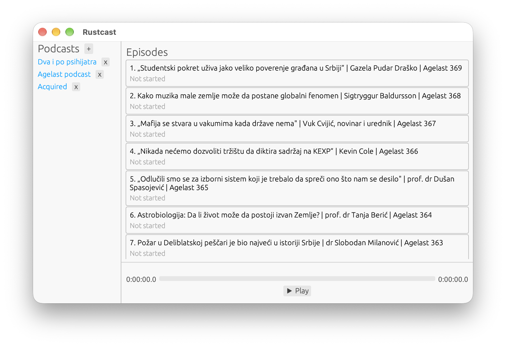

# Rustcast

An open-source podcast player built with Rust and [egui](https://github.com/emilk/egui).



## Features

- Search and subscribe to podcasts
- Browse and play episodes
- Track playback progress across episodes
- Auto-save and resume from where you left off
- Cross-platform: macOS, Linux, Windows

## Install

### From crates.io

```bash
cargo install rustcast-player
```

### From source

```bash
git clone https://github.com/nemanjapetrasinovic/rustcast.git
cd rustcast
cargo run --release
```

### Linux dependencies

On Linux, you need ALSA development libraries:

```bash
# Debian/Ubuntu
sudo apt-get install libasound2-dev
```

## Download

Pre-built binaries are available on the [Releases](https://github.com/nemanjapetrasinovic/rustcast/releases) page for:

- macOS (Apple Silicon) — `.app` bundle
- Linux (x86_64)
- Windows (x86_64) — `.exe`

> **macOS note:** Downloaded `.app` bundles may be blocked by Gatekeeper. Run `xattr -cr Rustcast.app` to fix this.

## License

GPL-3.0
